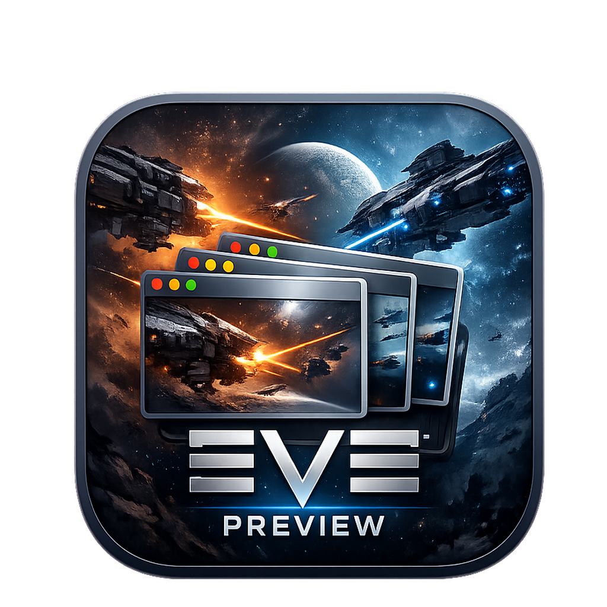
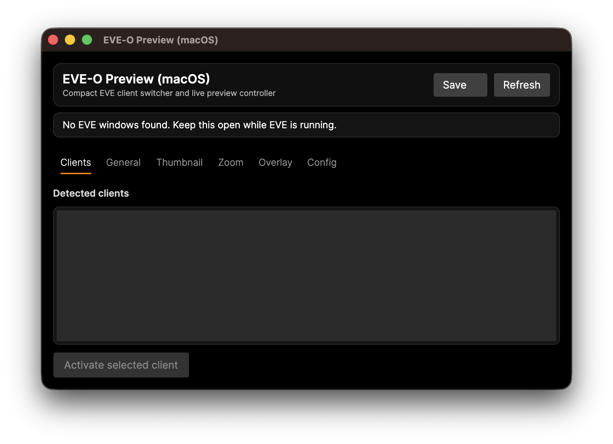
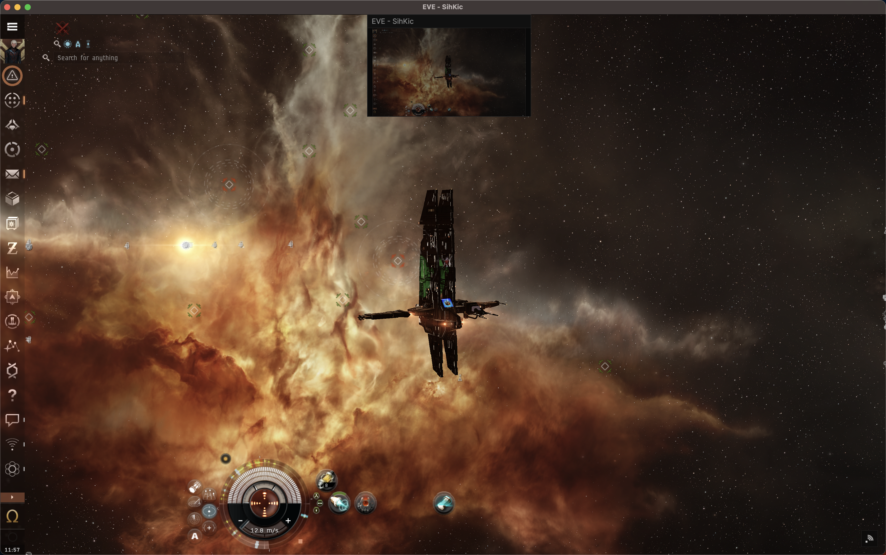

# EVE-O Preview for macOS



`EVE-O Preview for macOS` is a lightweight companion app for EVE Online multiboxing on macOS.

It helps you keep track of multiple running clients with live preview overlays and quick client switching, while staying focused on a simple, practical workflow.

## Screenshots

Main app window:



Overlay previews in action:



## What it does

- detects running EVE Online clients
- shows live thumbnail previews
- lets you click a preview to focus the matching client
- remembers thumbnail positions
- saves local app settings
- ships as a ready-to-test macOS `.app` and `.dmg`

## Built for macOS

This project is a dedicated macOS implementation built with:

- .NET 8
- Avalonia UI
- CoreGraphics
- AppleScript / System Events

## Install

Requirements: macOS 12 or later on Apple Silicon (M1 or newer). The prebuilt release is `arm64` only; Intel Macs need to [build from source](#build) with `RUNTIME=osx-x64`.

1. Download `EVE-O.Preview.zip` from the [latest release](https://github.com/ciws/eve-o-preview-macos/releases/latest).
2. Unzip it and move `EVE-O Preview.app` to `/Applications`.
3. The app is ad-hoc signed and not notarized, so Gatekeeper will block the first launch. Either:
   - open the app once, then go to **System Settings → Privacy & Security** and click **Open Anyway**, or
   - remove the quarantine flag from Terminal:

     ```bash
     xattr -dr com.apple.quarantine "/Applications/EVE-O Preview.app"
     ```

4. Launch the app and grant the permissions listed under [macOS permissions](#macos-permissions). After you grant Screen Recording, quit and reopen the app; macOS only applies that permission on the next launch.

## How to use

1. Start one or more EVE Online clients.
2. Launch `EVE-O Preview for macOS`.
3. Allow macOS permissions if prompted.
4. Use the main window to detect clients and manage settings.
5. Click a floating preview to bring the matching client to the front.

## Build

Prerequisites:

- Xcode Command Line Tools (`xcode-select --install`) for `sips`, `iconutil`, and `hdiutil`
- [.NET 8 SDK](https://dotnet.microsoft.com/download/dotnet/8.0), for example `brew install dotnet@8`

From the repository root:

```bash
./mac/scripts/build-dmg.sh
```

Build output:

- `mac/dist/EVE-O Preview.app`
- `mac/dist/eve-o-preview-mac-osx-arm64.dmg`

Optional Intel build:

```bash
RUNTIME=osx-x64 ./mac/scripts/build-dmg.sh
```

## macOS permissions

Depending on your macOS settings, the app may request access to:

- Accessibility
- Automation
- Screen Recording

These permissions are used for client discovery, activation, and preview capture.

## Project status

This is an early public macOS release focused on the core experience:

- find running EVE clients
- preview them live
- switch between them quickly

## Known limitations

- this is still an early macOS release
- some settings are visible but not implemented yet
- feature parity with the Windows ecosystem is not complete
- Apple Silicon build is the default packaged output

## Credits

- macOS port and current project work by `SihKic`
- inspired by the original `EVE-O Preview` idea and workflow created by the wider EVE multiboxing community

## Support

If this project is useful to you and you would like to support it, ISK donations are welcome in EVE Online.

- in-game character: `SihKic`

## Release

Prebuilt downloads are on the [Releases page](https://github.com/ciws/eve-o-preview-macos/releases). The current release ships `EVE-O.Preview.zip` (Apple Silicon `.app`).

Running `./mac/scripts/build-dmg.sh` locally produces:

- `mac/dist/eve-o-preview-mac-osx-arm64.dmg`
